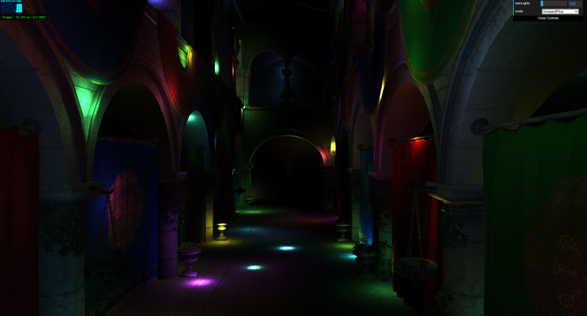
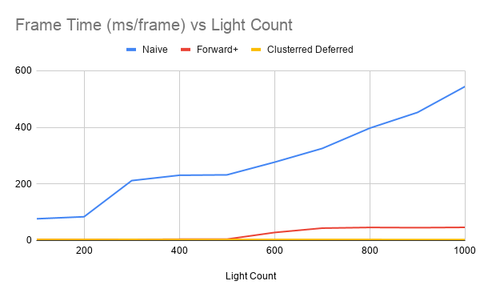
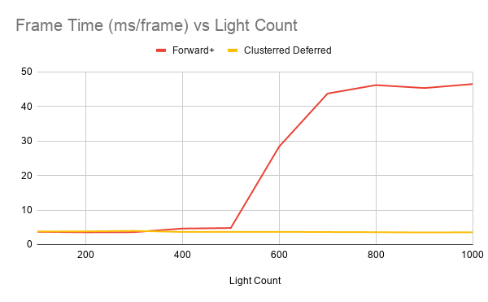
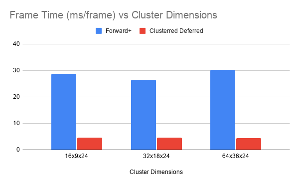

WebGPU Forward+ and Clustered Deferred Shading
======================

**University of Pennsylvania, CIS 565: GPU Programming and Architecture, Project 4**

* Nathan Chortek
  * [LinkedIn](https://www.linkedin.com/in/nathan-chortek/), [personal website](https://www.nathanchortek.com/)
* Tested on: Windows 11, AMD Ryzen AI 9 HX 370, NVIDIA GeForce RTX 5090 Laptop GPU

### Live Demo

http://nchortek.github.io/Project4-WebGPU-Forward-Plus-and-Clustered-Deferred

### Demo Video/GIF

<video src="https://github.com/user-attachments/assets/6765d3ec-849a-4bdc-974a-7abb03ec2b66" controls></video>

## Features Implemented

### Naive (Forward) Renderer

In the Naive renderer, each object is drawn in a single render pass, where the fragment shader loops over all lights
in the scene. Because the fragment shader runs for all fragments before fragments are culled by depth, this method's
performance is particularly sensitive to overdraw as well as scenes with many lights that do not actually contribute
to most visible fragments.

### Forward+ Renderer

In the Forward+ renderer, a compute pass first divides the view frustum into a 3D grid of clusters, broken into XY
pixel tiles and z-slices aligned with view-space depth. Typically the z-slices are biased closer to the camera, resulting 
in higher grid resolution in areas more visible to the user. For each cluster, an axis-aligned bounding box (AABB) is 
calculated in view space, and the light volumes that intersect that AABB are added to a per-cluster light list. Then, in 
a second (render) pass, each fragment determines the cluster that it is a part of and only computes lighting against the
lights in the cluster's light list. This method shares the Naive renderer's sensitivity to overdraw, but is more robust
to scenes with many lights, because fragments do not waste time iterating over lights that cannot contribute to their
shading calculations.

### Clustered Deferred Renderer

The Clustered Deferred renderer includes the same light clustering compute pass that is used by Forward+, but it instead
uses two render passes rather than one. In the first render pass, which runs over every object in the scene, no lighting 
calculations are made. Instead, a "G-Buffer" consisting of multiple textures are populated. Each texture stores only the 
data that a fragment needs for lighting calculations (e.g. position, normal, albedo, etc.). Depth-testing is enabled for
this path, which ensures that the G-Buffer's final contents contain only the data corresponding to the fragments that will
actually be visible on-screen. Following this G-Buffer population pass, a second render pass  occurs, this time over a 
full-screen triangle or quad, and lighting calculations occur (again only computing lighting for the lights in the fragment's
cluster). This approach largely solves the overdraw problem, because expensive fragment shader computations only occur for
fragments that are guaranteed to be visible to the user.

## Performance Analysis

All performance measurements are taken as an average over 200 frames, using a 16x9x24 cluster grid and 1000 lights,
unless stated otherwise.

### Frame Time vs Light Count

| Light Count | Naive (ms) | Forward+ (ms) | Clustered Deferred (ms) |
|------------:|-----------:|--------------:|------------------------:|
| 100  | 76.76  | 3.69  | 3.78 |
| 200  | 83.94  | 3.56  | 3.83 |
| 300  | 211.66 | 3.60  | 3.96 |
| 400  | 230.53 | 4.64  | 3.66 |
| 500  | 231.94 | 4.79  | 3.68 |
| 600  | 276.78 | 28.36 | 3.68 |
| 700  | 325.30 | 43.73 | 3.63 |
| 800  | 397.12 | 46.17 | 3.59 |
| 900  | 452.51 | 45.31 | 3.51 |
| 1000 | 544.27 | 46.48 | 3.56 |

### Frame Time vs Cluster Dimensions

| Cluster Dimensions | Forward+ (ms) | Clustered Deferred (ms) |
|-------------------:|--------------:|------------------------:|
| 16x9x24  | 28.73 | 4.61 |
| 32x18x24 | 26.50 | 4.53 |
| 64x36x24 | 30.17 | 4.34 |

### Naive Renderer

The best case for the Naive renderer is when the scene has very little overdraw and few lights. In such a scenario, the
overhead and memory cost of light clustering and/or G-Buffer writing confers little to no performance gains, and may even
be larger than the lighting computations, leading to performance losses. The worst case scenario for the Naive renderer is 
the inverse, where the scene has many lights and complex, occluding geometry.

### Forward+ Renderer

The best case scenario for the Forward+ renderer is when the scene has minimal overdraw and many lights that each intersect
a very small number of clusters. In this case, the cost of the light clustering compute pass is relatively small when compared
to the time saved by avoiding lighting calculations for lights that do not actually contribute to a given fragment. The worst
case scenario occurs when there are very few lights, or when the majority of lights do contribute to a majority of fragments,
in which case the compute pass becomes unnecessary overhead. Additionally, storing the cluster grid requires device memory,
which may or may not be scarce depending on the platform and application.

### Clustered Deferred Renderer

The best case scenario for the Clustered Deferred renderer is when the scene would otherwise have significant overdraw due to
occlusion or draw-order, as well as when there are many lights that each intersect a very small number of clusters. In this case,
the cost of the light custering compute pass and G-Buffer population pass is once again small when compared to avoiding the performance
costs associated with overdraw. The worst case scenario occurs in very simple scenes with few lights and minimal overdraw, in
which case these initial passes become pure overhead that do not warrant their cost. Compared to Forward+, a Clustered Deferred
renderer requires even more device memory, which again may be scarce depending on the platform and application.

### Credits

- [Vite](https://vitejs.dev/)
- [loaders.gl](https://loaders.gl/)
- [dat.GUI](https://github.com/dataarts/dat.gui)
- [stats.js](https://github.com/mrdoob/stats.js)
- [wgpu-matrix](https://github.com/greggman/wgpu-matrix)
